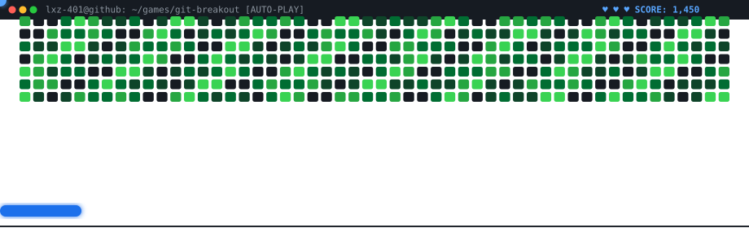

```
┌──(lxz-401㉿github)-[~]
└─$ whoami

┌──────────────────────────────────────────┐
│ Running identity.sh...                   │
└──────────────────────────────────────────┘

[████████████████████] 100%

OUTPUT:
┌───────────────┬──────────────────────────┐
│ lxz-401       │ Full-Stack Web Developer │
│ LOCATION      │ Navoiy, Uzbekistan       │
│ STATUS        │ active & coding...       │
└───────────────┴──────────────────────────┘

┌──(lxz-401㉿github)-[~]
└─$ check_skills

┌──────────────────────────────────────────┐
│ Initializing skill matrix...             │
└──────────────────────────────────────────┘

╔═══════════════════════════════════════════════════════════╗
║ COMPLETE SKILL MATRIX (LVL [0-10])                        ║
╠═══════════════════════════════════════════════════════════╣
║ JavaScript / TypeScript 8                                 ║
║ React & Next.js 8                                         ║
║ Node.js & Bun 7                                           ║
║ Linux & Shell Scripting 7                                 ║
║ Lua & Neovim Config 7                                     ║
║ Python & Django REST 6                                    ║
║ C++ / System Programming 5                                ║
╚═══════════════════════════════════════════════════════════╝

┌──(lxz-401㉿github)-[~]
└─$ ./launch_game.sh --profile lxz-401

┌───────────────────────────────────────────────────────────┐
│ 🎮 GIT-BREAKOUT: Contribution Graph Breaker Game          │
└───────────────────────────────────────────────────────────┘
```

<div align="center">
  <a href="https://lxz-401.github.io/lxz-401/">
    
  </a>
</div>

```
╔═══════════════════════════════════════════════════════════╗
║ ➤ PLAY ONLINE (LIVE IN BROWSER):                          ║
║   https://lxz-401.github.io/lxz-401/                      ║
║                                                           ║
║ ➤ PLAY IN TERMINAL:                                       ║
║   node cli.js                                             ║
║                                                           ║
║ ➤ CONTROLS:                                               ║
║   [← / A] [→ / D] Move  |  [SPACE] Launch / Pause         ║
║   [R] Restart / Reset   |  [Q] Quit                       ║
╚═══════════════════════════════════════════════════════════╝

┌──(lxz-401㉿github)-[~]
└─$ ./status.sh

┌──────────────────────────────────────────┐
│ Checking current status...               │
└──────────────────────────────────────────┘

[AVAILABLE] ██████████ 100%
[CODING] █████░░░░░ 50%
[DEBUGGING] ██░░░░░░░░ 15%
[SLEEPING] █░░░░░░░░░ 5%

┌──────────────────────────────────────────┐
│ Fetching contact information...          │
└──────────────────────────────────────────┘

╔═══════════════════════════════════════════════════════════╗
║ CONTACT CHANNELS                                          ║
╠═══════════════════════════════════════════════════════════╣
║ [EMAIL]    → azikdev23@gmail.com                          ║
║ [TELEGRAM] → @lxz_401                                     ║
║ [GITHUB]   → github.com/lxz-401                           ║
║ [STATUS]   → Open for Collaboration & Projects            ║
╚═══════════════════════════════════════════════════════════╝

┌──(lxz-401㉿github)-[~]
└─$ ls projects/

┌──────────────────────────────────────────┐
│ Loading project directory...             │
└──────────────────────────────────────────┘

drwxr-xr-x  9 lxz-401  lxz-401  288 Oct 07 2026  media-controls/
drwxr-xr-x  8 lxz-401  lxz-401  256 Sep 12 2026  NitroVim/
drwxr-xr-x  7 lxz-401  lxz-401  224 Oct 02 2026  rovyl/
drwxr-xr-x  6 lxz-401  lxz-401  192 Sep 17 2026  NitroOS/
drwxr-xr-x  8 lxz-401  lxz-401  256 Oct 10 2026  nitro-os.github.io/
drwxr-xr-x  5 lxz-401  lxz-401  160 Sep 19 2026  mousiki/
drwxr-xr-x  4 lxz-401  lxz-401  128 Sep 23 2026  olx-mcp-server/

┌──(lxz-401㉿github)-[~]
└─$ cat projects/featured.txt

╔═══════════════════════════════════════════════════════════╗
║ FEATURED PROJECTS                                         ║
╠═══════════════════════════════════════════════════════════╣
║                                                           ║
║ 🎵 Media Controls (GNOME Shell)                           ║
║    ├─ MPRIS client & media widget for GNOME Shell         ║
║    ├─ Tech: JavaScript, GJS, GNOME Shell, CSS             ║
║    └─ Status: [ACTIVE] (440+ Commits)                     ║
║                                                           ║
║ 🔥 NitroVim (Neovim IDE Distribution)                     ║
║    ├─ Fast, modular Neovim setup with LSP & Treesitter    ║
║    ├─ Tech: Lua, Neovim, Treesitter, LSP                  ║
║    └─ Status: [ACTIVE] (340+ Commits)                     ║
║                                                           ║
║ 🎯 Rovyl (Radial App Launcher)                            ║
║    ├─ Gesture & radial mouse launcher for Windows         ║
║    ├─ Tech: JavaScript, Windows API, Automation           ║
║    └─ Status: [STABLE] (250 Commits)                      ║
║                                                           ║
║ 💿 NitroOS (Live USB Distribution)                        ║
║    ├─ Custom lightweight Linux OS with custom shell       ║
║    ├─ Tech: Linux, Shell, Neovim, Lua                     ║
║    └─ Status: [ACTIVE] (150+ Commits)                     ║
║                                                           ║
║ 🔌 OLX MCP Server                                         ║
║    ├─ Model Context Protocol server for OLX.uz analytics  ║
║    ├─ Tech: TypeScript, MCP SDK, Node.js                  ║
║    └─ Status: [ACTIVE]                                    ║
║                                                           ║
╚═══════════════════════════════════════════════════════════╝

┌──(lxz-401㉿github)-[~]
└─$ ./get_stats.sh --github

┌──────────────────────────────────────────┐
│ Fetching GitHub statistics...            │
└──────────────────────────────────────────┘

[████████████████████] 100%

╔═══════════════════════════════════════════════════════════╗
║ GITHUB STATISTICS                                         ║
╠═══════════════════════════════════════════════════════════╣
║ Public Repositories   : 19                                ║
║ Total Commits         : 1,500+                            ║
║ Total Stars Earned    : 25+                               ║
║ Primary Languages     : JS, TS, Lua, Shell, C++, Python   ║
║ Active Ecosystems     : NitroOS, CyberCraft, GNOME, MCP   ║
║ Collaboration Status  : Open for Work                     ║
╚═══════════════════════════════════════════════════════════╝

┌──(lxz-401㉿github)-[~]
└─$ cat /etc/motd

  ██╗     ██╗  ██╗███████╗      ██╗  ██╗ ██████╗  ██╗
  ██║     ╚██╗██╔╝╚══███╔╝      ██║  ██║██╔═████╗███║
  ██║      ╚███╔╝   ███╔╝ █████╗███████║██║██╔██║╚██║
  ██║      ██╔██╗  ███╔╝  ╚════╝╚════██║████╔╝██║ ██║
  ███████╗██╔╝ ██╗███████╗           ██║╚██████╔╝ ██║
  ╚══════╝╚═╝  ╚═╝╚══════╝           ╚═╝ ╚═════╝  ╚═╝

  ┌─────────────────────────────────────────────────────┐
  │ "Code is like humor. When you have to explain it,   │
  │  it's bad." - Cory House                            │
  └─────────────────────────────────────────────────────┘

┌──(lxz-401㉿github)-[~]
└─$ history | tail -5

  498  nvim ~/.config/nvim/init.lua
  499  git commit -m "feat: enhance radial menu gestures"
  500  npm run dev
  501  git push origin main
  502  node cli.js

┌──(lxz-401㉿github)-[~]
└─$ echo $CURRENT_FOCUS

[█████████░] 90% - NitroOS & NitroVim Linux Ecosystem
[████████░░] 80% - CyberCraft Launcher & Mods
[████████░░] 80% - Rovyl & Desktop Productivity Utilities
[██████████] 100% - OLX MCP Server & Web Applications

┌──(lxz-401㉿github)-[~]
└─$ cat ~/.config/interests.conf

╔═══════════════════════════════════════════════════════════╗
║ INTERESTS & HOBBIES                                       ║
╠═══════════════════════════════════════════════════════════╣
║ [✓] Full-Stack Web Development                            ║
║ [✓] Game Development & Modding                            ║
║ [✓] Bot Development & Automation                          ║
║ [✓] Open Source Contribution                              ║
║ [✓] Cybersecurity & Ethical Hacking                       ║
║ [✓] Problem Solving & Algorithms                          ║
╚═══════════════════════════════════════════════════════════╝

┌──(lxz-401㉿github)-[~]
└─$ sudo apt install collaboration

Reading package lists... Done
Building dependency tree... Done

Do you want to collaborate? [Y/n] Y

╔═══════════════════════════════════════════════════════════╗
║ COLLABORATION STATUS: OPEN                                ║
╠═══════════════════════════════════════════════════════════╣
║ I'm always open to:                                       ║
║  • Interesting projects                                   ║
║  • Open source contributions                              ║
║  • Learning new technologies                              ║
║  • Sharing knowledge                                      ║
║                                                           ║
║ Feel free to reach out! 🚀                                ║
╚═══════════════════════════════════════════════════════════╝

┌──(lxz-401㉿github)-[~]
└─$ exit

logout
Connection to github.com closed.
```

<div align="center">


[](https://github.com/lxz-401)

**⭐ Star my repositories if you find them useful! ⭐**

</div>
